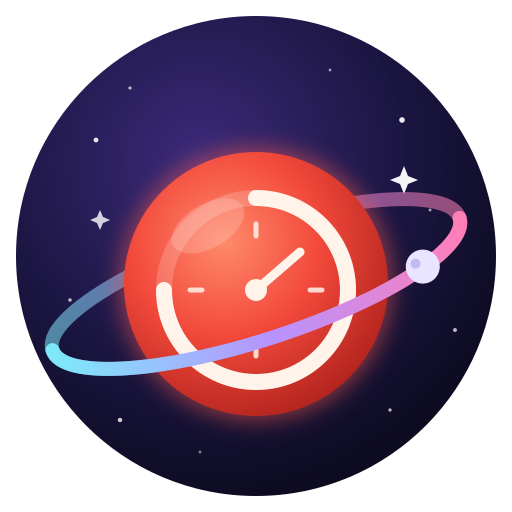

<p align="center"></p>
<h2 align="center">Cosmic Doro</h2>
<p align="center"><em>A cosmic pomodoro focus timer for the COSMIC™ desktop, written in Rust with libcosmic.</em></p>

Inspired by [Concentré](https://github.com/vjousse/concentre), rebuilt natively for COSMIC.

## Features

- **Native COSMIC app** built on `libcosmic`: follows your accent color, light/dark mode,
  frosted/translucent windows and corner radii live, just like first-party COSMIC apps.
- **Panel applet**: a progress ring (plus remaining time) sits in your panel or dock; click it for a
  popup with start/pause, restart, skip, today's progress and a shortcut to reports.
- **Tasks page**: plan tasks with estimated pomodoros, press *Focus* to work on one, and finished focus
  sessions are counted against it automatically. Filter active/completed, adjust estimates, clear done.
- **Tray icon** (via COSMIC's Status Area): a live progress ring in the phase color. Left-click opens the
  window, middle-click starts/pauses, and the menu has start/pause, skip, restart, reset, a task picker and
  shortcuts to Reports and Settings. It keeps the timer and notifications running after you close the
  window, and can start at login.
- **COSMIC desktop notifications** when a phase ends, with a *Start break / Start focus* action button
  and optional sound.
- **Focus, short break and long break** with configurable durations, rounds and auto-start.
- **Reports**: today vs. daily goal, current and best streaks, last 7 days chart with goal line,
  18-week activity heatmap, focus-by-hour chart (find your peak hour), top focus areas, personal
  bests and recent sessions.
- Stopwatch-style ring whose color warms up as a focus session nears its end.

The window and the applet share one timer: either one can run alone, and whichever notices first that
a phase has ended completes it (atomic claim file, so you never get duplicate notifications or log entries).

## Install

Requires Rust (stable) and the usual libcosmic build deps (`libxkbcommon-dev`, `libwayland-dev`, `pkg-config`).

```sh
./install.sh            # builds in release mode and installs into ~/.local
./install.sh uninstall
```

Then add the applet: **Settings → Desktop → Panel → Configure panel applets → Add applet → Cosmic Doro**.

You can also open the window on a specific page: `cosmic-doro --tasks`, `--reports` or `--settings`.

## Files

| What | Where |
| --- | --- |
| Settings | `~/.config/cosmic-doro/settings.json` |
| Live timer state | `~/.local/state/cosmic-doro/timer.json` |
| Session history | `~/.local/share/cosmic-doro/history.jsonl` |
| Tasks | `~/.local/share/cosmic-doro/todos.json` |

## Development

```sh
cargo run --bin cosmic-doro
cargo run --bin cosmic-doro-applet   # runs as a floating window outside the panel
cargo test
```
